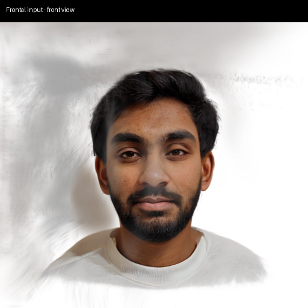
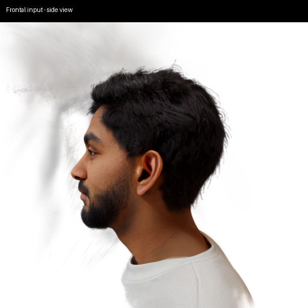
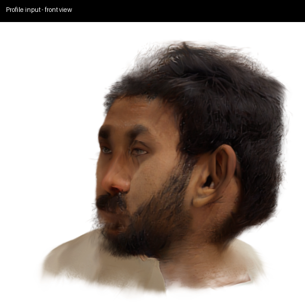
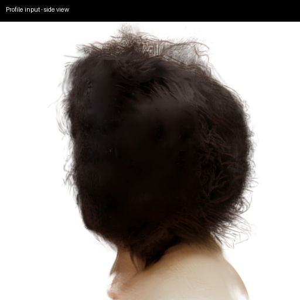

# Task 5 — Single-image 3D face reconstruction with FaceLift

## Method

This project uses [FaceLift](https://github.com/weijielyu/FaceLift), which predicts a full-head 3D Gaussian representation from one facial image and renders it from multiple views. I chose it to produce a viewable head representation without the separately licensed FLAME asset required by the DECA setup. The frontal and profile photographs were processed in separate runs; they were not fused.

The notebook clones the upstream code at runtime. FaceLift's code is Apache 2.0, while its model weights use the [Adobe Research License](https://github.com/weijielyu/FaceLift/blob/main/Adobe%20Research%20License%20v1.2.txt). Model weights and original personal photographs are not included in this repository.

## Inputs and privacy

The two original photographs were taken in the same session and uploaded separately to ORTUS as required. They were uploaded directly to the temporary Colab runtime for inference and are excluded from Git by `.gitignore`. The run used FaceLift's automatic face detection/cropping. Background removal was disabled to avoid an incompatible optional CuPy dependency; this change is made by the notebook patch cell and is recorded here.

## Environment and reproduction

The successful run used Google Colab with a Tesla T4 GPU:

| Component | Version / setting |
|---|---|
| Python | 3.12.13 |
| PyTorch | 2.4.0+cu124 |
| CUDA runtime (PyTorch) | 12.4 |
| GPU | Tesla T4 |
| FaceLift commit | `0a9420c1480db1e22daa6dee192b76a013295992` |
| Inference settings | Seed 4; automatic face crop; 50 diffusion steps |

Open [FaceLift_Colab.ipynb](FaceLift_Colab.ipynb) in Colab, select a GPU runtime (tested with Runtime version 2026.07 and a T4), then run cells in order and upload both original images when prompted. The notebook installs dependencies, applies compatibility changes for the Python 3.12/T4 runtime, runs each photo independently, checks the expected outputs and downloads a ZIP. The successful output archive contained `gaussians.ply`, `output.png`, and `turntable.mp4` for each input. The archive was 131 MB; the output models and videos are not checked into this repository. Screenshots from the outputs are included below and in `outputs/screenshots/`.

The notebook applies these runtime compatibility changes to the upstream project:

- Uses scikit-image 0.24.0 for the Colab Python 3.12 runtime and builds the Gaussian rasterizer without pip build isolation.
- Uses CUTLASS attention, which works on the T4; the upstream forced Flash Attention kernel rejected the T4's compute capability.
- Bypasses optional background removal because Colab's CuPy package was incompatible with the pinned NumPy. Face detection/cropping remains enabled; if preprocessing fails, the original image is resized by the upstream fallback.

The downloaded pretrained model weights are not committed. The notebook downloads them automatically from Hugging Face on first inference, subject to the model's license.

## Results and analysis

Both frontal and profile inputs completed and produced separate Gaussian representations, rendered view images and turntable videos. Four labelled viewpoints from the turntables are shown here:

### Frontal input

| Front view | Side view |
|---|---|
|  |  |

The frontal result retains the broad face layout, including eye placement, nose, beard and jaw outline. Its side rendering gives a plausible head profile, although fine hair and shoulder/background boundaries look soft.

### Profile input

| Front view | Side view |
|---|---|
|  |  |

The profile-input result completed, but is visibly less reliable: one generated view is dominated by the back of the head and contains little facial detail. The input pose and the model's view synthesis likely contribute. It should be reported as a successful run with a weak/limited visual result, not as a precise profile reconstruction.

Because each run sees only its own image, the unseen side and back of the head are model predictions. These renders demonstrate visual plausibility, not verified geometry or physical measurements. A calibrated 3D scan or a separate measured photograph from another viewpoint would provide an independent check; no millimetre accuracy is claimed.

## Output files

The complete downloaded archive included:

- `frontal/frontal/gaussians.ply`, `output.png`, and `turntable.mp4`
- `profile/profile/gaussians.ply`, `output.png`, and `turntable.mp4`
- Four labelled screenshots under `screenshots/`

The `.ply` Gaussian representations are FaceLift's native 3D outputs. Converting them to polygon meshes is not required. Keep the ZIP as the saved full result and submit the required screenshots and original images to ORTUS.

## Sources and AI assistance

- FaceLift project and code: <https://github.com/weijielyu/FaceLift>
- FaceLift paper: *FaceLift: Learning Generalizable Single Image 3D Face Reconstruction from Synthetic Heads*, ICCV 2025.
- OpenAI Codex assisted with preparing the Colab notebook, troubleshooting the Colab/T4 compatibility issues, and documenting the results. The student should be able to explain the workflow, compatibility changes and analysis.
